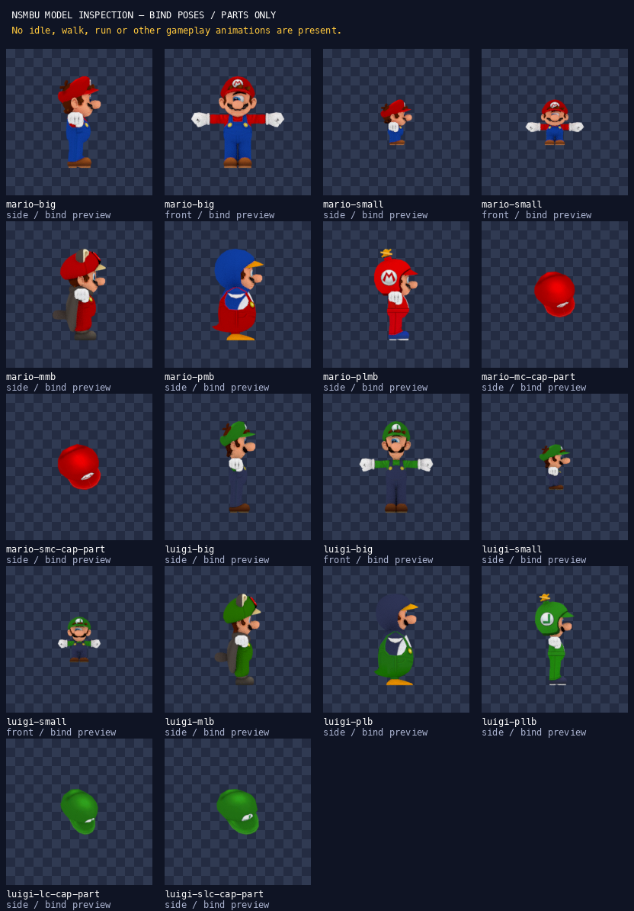

# NSMBU character model inspection and render pipeline

**Completed: safe extraction, source hashes, skeleton/skin/material inspection and 18 reproducible transparent orthographic previews. Blocked: original gameplay animation.** No compatible original clips were acquired; no `manifest-fragment.json`, player atlas, game change or shared manifest edit was produced. Nothing was staged, committed or pushed.

Inspection date: 1 November 2026. Scope: only this directory and `web/public/packs/mario/characters/model-preview/`. Shared `docs/CHECKLIST.md`, build scripts, credits and existing player art belong to the coordinator and were not edited. AGENTS.md, SPEC.md, CHECKLIST.md, pack README and the pack-local RESOLUTION_REPORT.md were read. There is no root-level RESOLUTION_REPORT.md.

## Source files and unchanged originals

The user manually downloaded the ZIPs to `/Users/slimane/Downloads/realmforge-rips`. Extraction rejects traversal, absolute/Windows paths, duplicate case-insensitive paths, symlinks, special files, encryption and oversized entries. It validates the complete member list before writing, refuses symlink destinations and differing existing files, and writes under `extracted/` only. No external XML declarations are accepted. Archive SHA-256 is checked before/after extraction and again during final verification.

| Original full filename | Bytes | SHA-256 | Extracted files |
|---|---:|---|---:|
| `Wii U - New Super Mario Bros. U _ New Super Luigi U - Playable Characters - Mario.zip` | 449314 | `acf85fce8461fd652889b00124c0bbc484ee29f30f3a145c17d541645a0c5efb` | 44 |
| `Wii U - New Super Mario Bros. U _ New Super Luigi U - Playable Characters - Luigi.zip` | 432777 | `30241c7a016e5d15efe9a91f5ac79528dd672e07108a78e901cdcafb15438114` | 42 |

Totals: **24 DAE models, 60 PNG textures, 2 README files**, 86 files excluding ZIP directory entries. Each individual file's original archive member name, destination, byte count and SHA-256 is recorded in [source-lock.json](source-lock.json). Extracted source files are byte-identical to the archive entries. The original READMEs identify Nintendo's NSMBU, ripper DogToon64, required Nintendo credit and optional ripper credit; they do **not** provide a per-model form/assembly or animation table. See [CREDITS.md](CREDITS.md).

## Blender import probe and supported conversion scope

First probe, before extraction/import, actually returned:

```text
BLENDER_VERSION 5.2.1 LTS
COLLADA_IMPORT_OPERATORS []
```

Full evidence: [blender-probe.txt](evidence/blender-probe.txt). No missing Blender Collada operator was invoked. Instead, **pycollada 0.9.3 (BSD)** in `/tmp/realmforge-character-model-venv` parses the original meshes, triangle indices, per-corner normals/UVs, scene matrices, instance-material bindings, skins and joint inverse binds. Licence was reviewed before installation. Scratch tools/versions/licences are documented locally; no npm/runtime dependency changed.

The local bridge deliberately supports **these static source files only**. It verifies that every source controller's scene transform and bind-shape matrix are identity and that each `globalRestJoint × inverseBindJoint` is identity within 0.001; the largest measured deviation is below 0.000017. It checks every vertex weight sum, then preserves the already-bound source mesh coordinates. It does **not** create a Blender armature or claim to be a general animated Collada converter. Animated DAE input is rejected. All source rigs, inverse binds and influence counts remain inspectable in [model-inventory.json](model-inventory.json) and [geometry-evidence.json](geometry-evidence.json).

## Verified standard assemblies

Form labels below are supported by the archive character identity, measured body geometry/proportions, actual material bindings and the rendered result, rather than merely expanding filename initials. The smaller bodies are genuinely different geometry, not scaled copies. Both source sizes use their own character's textures; Luigi is not recoloured Mario.

| Form | Body + head | Body Y extent | Body/head triangles | Evidence |
|---|---|---:|---:|---|
| Mario big | `MB_model.dae` + `MH_model.dae` | 21.966 | 1126 / 903 | Distinct source geometry; bound `player_body.0.png`, `player_head.0.png`, `player_eye.0.png` |
| Mario small | `SMB_model.dae` + `SMH_model.dae` | 12.016 | 1074 / 927 | Distinct source geometry; bound `player_body.0.png`, `player_head.0.png`, `player_eye.0.png` |
| Luigi big | `LB_model.dae` + `LH_model.dae` | 23.803 | 1136 / 866 | Distinct source geometry; bound `player_body.0.png`, `player_head.0.png`, `player_eye.0.png` |
| Luigi small | `SLB_model.dae` + `SLH_model.dae` | 12.625 | 1080 / 890 | Distinct source geometry; bound `player_body.0.png`, `player_head.0.png`, `player_eye.0.png` |

Body geometry is Y-up with arms extending along X. Standard heads are separately modelled in head-local coordinates (their forward axis is local +X); simply loading the files together at the origin would leave the head disconnected. The inspection assembly places the head with the body's **existing global `face_1` matrix**, derived by multiplying the source hierarchy's local matrices. There is no hand-tuned head offset, mesh scaling or invented pose. The character's forward direction becomes source +Z. Four front views additionally verify the assembled proportions and distinct Luigi face/body.

`MH/SMH/LH/SLH` each contain four skinned geometries with `mat_player_eye`, `mat_player_face`, `mat_player_hair`, `mat_player_hat`. Thus the normal head **already contains its worn cap**. `MC/SMC/LC/SLC` each contain a single `mat_player_hat` mesh, bound to the separate `mario_cap` or `luigi_cap` root. These are rendered as separate source-local parts. They are **not** stacked on the hat already present in the head. `CapPosition` is a right-wrist attachment in the body rig, but the archives contain no explicit cross-file cap attachment or animation track establishing a worn/held state, so no such animated assembly is asserted.

Other verified matching body/head pairs are also previewed with their **source stems** retained in filenames:

| Mario pair | Luigi pair | Observable geometry/texture evidence |
|---|---|---|
| `MMB/MMH` | `MLB/MLH` | Ear/tail/winged suit; 24-bone body with explicit `wing*` joints; `player_mbody.0`, `player_mhead.0`, `P`. This is not identified as a mini form from the letter M. |
| `PMB/PMH` | `PLB/PLH` | Penguin-shaped suit, beak/flippers/feet; `player_pbody`, `player_phead`; source listing includes Penguin Suit. |
| `PLMB/PLMH` | `PLLB/PLLH` | Helmet/rotor geometry; `player_plbody`, `player_plface`, `player_plhead`; head has `player_plp` rotor joint. |

These pairs are connected through their own source `face_1` matrices, visually checked on the sheet, and remain bind-pose previews. No alternate suit is a new gameplay form or animation deliverable.

## Rig and skin names

Standard bodies (`MB`, `SMB`, `LB`, `SLB`) have **17 joints**:

```text
mario_all_root / luigi_all_root
  skl_root
    leg_l1 → leg_l2 → ankle_l1
    leg_r1 → leg_r2 → ankle_r1
    spin
      arm_l1 → arm_l2 → wrist_l1
      arm_r1 → arm_r2 → wrist_r1 → CapPosition
      face_1
```

Standard heads have the single joint `player_head`; detached caps use `mario_cap` / `luigi_cap`. The other bodies have the same 17-joint set except `MMB/MLB`, which add **seven joints**: `wing_legL`, `wing_legR`, `wing_armL`, `wing_armR`, `wing`, `wing_tail1`, `wing_tail2` (24 total). `PLMH/PLLH` heads have `player_head` and `player_plp`; all other heads have `player_head` alone.

Full parent relationships, source-local matrices, joint names used by each skin, material/image declarations and instance bindings are in [model-inventory.json](model-inventory.json). [geometry-evidence.json](geometry-evidence.json) adds evaluated global joint matrices, inverse binds, weighted-vertex counts, maximum influences per vertex, triangle counts, geometry bounds, resolved diffuse texture filenames/hashes and sampler modes for **all 24 files**. A matching name set alone does not establish animation compatibility: the rest matrices differ between Mario/Luigi and big/small.

## Materials, camera and rendering

- Diffuse textures are resolved through the original `instance_material → material → effect → sampler → surface → image` chain. No material is selected by guessing a PNG name. Standard body/head diffuse textures are 128×128; the eye texture is 32×128. All original PNGs are kept at their original size.
- Original sampler combinations include `MIRROR/MIRROR`, `MIRROR/WRAP`, `MIRROR/CLAMP`, `CLAMP/CLAMP`. The bridge preserves these **per axis**, including mirrored eye/face UVs. It does not clamp away negative UVs or repeat an eye incorrectly. Normals and UV seams use source per-corner indices.
- The DAE's opaque diffuse semantics are retained; it declares no transparent phong input. The **render background** is transparent. Neutral studio light, Standard colour transform, roughness 1 and no specular are used for inspection. Original Nintendo console shaders, environment maps and runtime material animation are not recreated. The unbound alternate colour/eye textures remain untouched and are not interpreted as animation frames.
- Right-handed axis conversion maps source `(x,y,z)` to Blender `(z,-x,y)`. Side camera is along Blender −Y, character facing +X; front camera is along +X. Detached caps retain source-local orientation, so their side previews are technical part views, not a guessed worn-cap orientation.
- Direct **192×192 RGBA**, orthographic, CPU Cycles, 32 samples, seed 0, four fixed threads, no denoising. Camera framing targets **120px** character height (big/suits), **60px** (small/cap parts), with up to two antialiasing edge pixels. No raster enlargement, mesh scaling, pose editing, interpolation or synthetic frame generation occurs.
- Blender writes changing Date/RenderTime metadata. The first byte-hash repeat check failed on that metadata. `png_metadata.py` now removes only volatile PNG text chunks; IDAT/compressed image data is retained byte-for-byte. Decoded pixels were checked unchanged. The complete rerender subsequently produced identical SHA-256 values for all 18 PNGs.

## Successful render files

All below are **inspection stills**. [render-results.json](render-results.json) contains exact PNG SHA-256, bounds, camera scale, target height and zero-action count. No frame sequence, atlas or animation manifest exists.

| Preview | Path |
|---|---|
| mario-big — side | [mario-big-side-bind-preview.png](../../../../web/public/packs/mario/characters/model-preview/mario-big-side-bind-preview.png) |
| mario-big — front | [mario-big-front-bind-preview.png](../../../../web/public/packs/mario/characters/model-preview/mario-big-front-bind-preview.png) |
| mario-small — side | [mario-small-side-bind-preview.png](../../../../web/public/packs/mario/characters/model-preview/mario-small-side-bind-preview.png) |
| mario-small — front | [mario-small-front-bind-preview.png](../../../../web/public/packs/mario/characters/model-preview/mario-small-front-bind-preview.png) |
| mario-mmb — side | [mario-mmb-side-bind-preview.png](../../../../web/public/packs/mario/characters/model-preview/mario-mmb-side-bind-preview.png) |
| mario-pmb — side | [mario-pmb-side-bind-preview.png](../../../../web/public/packs/mario/characters/model-preview/mario-pmb-side-bind-preview.png) |
| mario-plmb — side | [mario-plmb-side-bind-preview.png](../../../../web/public/packs/mario/characters/model-preview/mario-plmb-side-bind-preview.png) |
| mario-mc-cap-part — side | [mario-mc-cap-part-side-bind-preview.png](../../../../web/public/packs/mario/characters/model-preview/mario-mc-cap-part-side-bind-preview.png) |
| mario-smc-cap-part — side | [mario-smc-cap-part-side-bind-preview.png](../../../../web/public/packs/mario/characters/model-preview/mario-smc-cap-part-side-bind-preview.png) |
| luigi-big — side | [luigi-big-side-bind-preview.png](../../../../web/public/packs/mario/characters/model-preview/luigi-big-side-bind-preview.png) |
| luigi-big — front | [luigi-big-front-bind-preview.png](../../../../web/public/packs/mario/characters/model-preview/luigi-big-front-bind-preview.png) |
| luigi-small — side | [luigi-small-side-bind-preview.png](../../../../web/public/packs/mario/characters/model-preview/luigi-small-side-bind-preview.png) |
| luigi-small — front | [luigi-small-front-bind-preview.png](../../../../web/public/packs/mario/characters/model-preview/luigi-small-front-bind-preview.png) |
| luigi-mlb — side | [luigi-mlb-side-bind-preview.png](../../../../web/public/packs/mario/characters/model-preview/luigi-mlb-side-bind-preview.png) |
| luigi-plb — side | [luigi-plb-side-bind-preview.png](../../../../web/public/packs/mario/characters/model-preview/luigi-plb-side-bind-preview.png) |
| luigi-pllb — side | [luigi-pllb-side-bind-preview.png](../../../../web/public/packs/mario/characters/model-preview/luigi-pllb-side-bind-preview.png) |
| luigi-lc-cap-part — side | [luigi-lc-cap-part-side-bind-preview.png](../../../../web/public/packs/mario/characters/model-preview/luigi-lc-cap-part-side-bind-preview.png) |
| luigi-slc-cap-part — side | [luigi-slc-cap-part-side-bind-preview.png](../../../../web/public/packs/mario/characters/model-preview/luigi-slc-cap-part-side-bind-preview.png) |



The contact sheet's checkerboard is a viewing aid only. Each standalone PNG has a genuinely transparent background and is placed on the sheet at 1:1 without resizing.

## Missing-animation evidence and next input

Local XML traversal of **all 24 DAE files** reports **zero `<animation>`, `<animation_clip>`, animation `<channel>` or animation `<sampler>` elements**. Rigged meshes and alternate texture images do not contain timed movement. Blender reports **zero actions for every render**. Nothing is labelled idle, walk, run or any other gameplay action.

[RESEARCH.md](RESEARCH.md) records reviewed primary-source pages, rejected routes, searches and precise acquisition instructions. The correct [Mario source page](https://models.spriters-resource.com/wii_u/newsupermariobrosu/asset/332841/) also has the uploader's reply that animations are not included. No compatible original downloadable `.bfres/.bfska/.dae/.smd` clip was obtained, so there was **no actual external skeleton/channel mapping to test** and no compatibility claim.

The remaining required delivery is original timed skeletal clips covering `idle`, `walk`, `run`, `skid`, `jump`, `fall`, `crouch`, `wallSlide`, `dead` for **all four standard forms**, with their matching reference skeleton, native names, interpolation/timing and companion material/eye tracks where applicable. Supply the original BFRES FSKA sections or faithful full-animation exports, with original paths/hashes. The archives do not establish exact original on-disk animation filenames; inventing a file list would be misleading. Request raw containers plus the reference rig, then enumerate their actual channels as detailed in RESEARCH.md. A new verified evaluator is required before rendering real cycles; the current static bridge deliberately refuses animated inputs.

## Reproduction and actual verification

From the repository root, using a disposable Python environment (Blender is the already installed application):

```sh
python3 -m venv /tmp/realmforge-character-model-venv
/tmp/realmforge-character-model-venv/bin/python -m pip install -r assets/packs/mario/character-model-import/requirements.lock
/tmp/realmforge-character-model-venv/bin/python assets/packs/mario/character-model-import/run_pipeline.py
```

`--downloads` and `--blender` accept explicit alternative locations. The runner probes Blender first, safely re-extracts/verifies the original files, prepares scene data, renders, verifies and creates the contact sheet. For byte-identical comparisons use this Blender build and the pinned Python packages; another Blender version is not claimed byte-identical. The verified baseline is `evidence/first-render-results.json` (after removing volatile text metadata); initial unnormalized hashes remain in `evidence/first-render-attempt.json` for audit.

Actual final validator output:

```text
test_directory_and_regular_file_allowed (__main__.ArchiveSafety.test_directory_and_regular_file_allowed) ... ok
test_symlink_rejected (__main__.ArchiveSafety.test_symlink_rejected) ... ok
test_traversal_absolute_windows_and_case_collisions (__main__.ArchiveSafety.test_traversal_absolute_windows_and_case_collisions) ... ok

----------------------------------------------------------------------
Ran 3 tests in 0.001s

OK
PASS: 2 original ZIPs and 86 extracted source files match SHA-256 locks
PASS: 24 DAE files; 0 animations, animation clips, channels or animation samplers
PASS: source diffuse textures, per-corner UV/normal counts and skin bind identities
PASS: 18 RGBA 192x192 orthographic stills; alpha background; no clipping; 60/120px height budgets; no actions/manifest fragment
PASS: repeated Blender render has identical SHA-256 for all 18 PNGs
```

Actual final pipeline output ends:

```text
PASS: render.txt
PASS: validation.txt
PASS: contact-sheet.txt
PASS: pipeline complete; inspection-only output; no gameplay animation or manifest fragment
```

Full commands/results: [pipeline.txt](evidence/pipeline.txt), [inspection.txt](evidence/inspection.txt), [preparation.txt](evidence/preparation.txt), [render.txt](evidence/render.txt), [validation.txt](evidence/validation.txt), [pixel-checks.json](evidence/pixel-checks.json). The three extraction tests cover accepted members and rejected traversal/absolute/Windows paths, case collisions and symlink entries. Output verification checks original/extracted hashes, absent animation data, diffuse texture hashes, UV/normal counts, bind matrices, RGBA dimensions/background, no clipping, height budgets, zero actions, no fragment and repeated PNG hashes.

Package tests/builds were **not run**: no gameplay, smart contract, package dependency, shared build or runtime manifest code changed. The relevant asset pipeline and its checks passed. Existing pack fidelity blockers are not resolved by these bind previews.

## Coordinator handoff

- Safe extraction/model inspection/render-preview item can be marked complete with the above evidence. Record the Nintendo/DogToon64 source credits from this directory's CREDITS.md in shared credits if retaining this work.
- Keep exact NSMBU character animation fidelity **open**. Original compatible clips and a verified animation evaluator remain missing. Existing working player art stays in place.
- Do not merge these bind poses into character animation entries. No `manifest-fragment.json` was emitted. Only the two assigned directory trees were written; shared checklist/manifest/build scripts and existing atlases were untouched.
