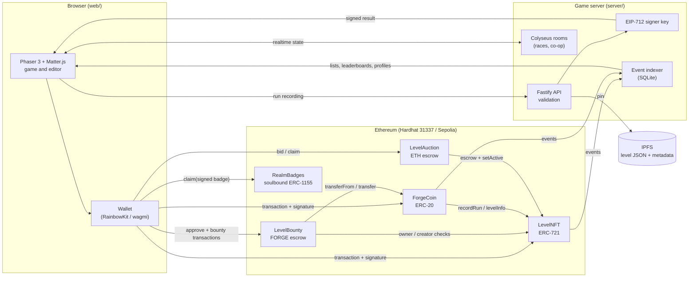
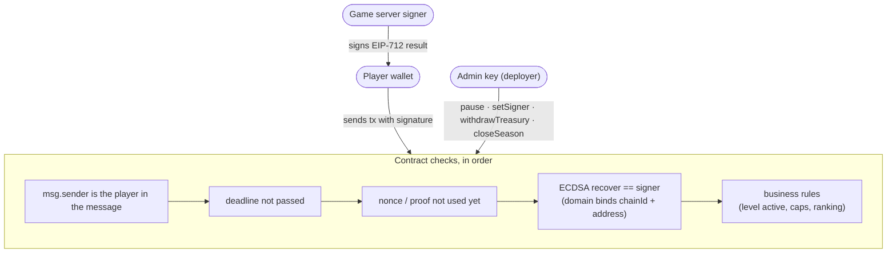
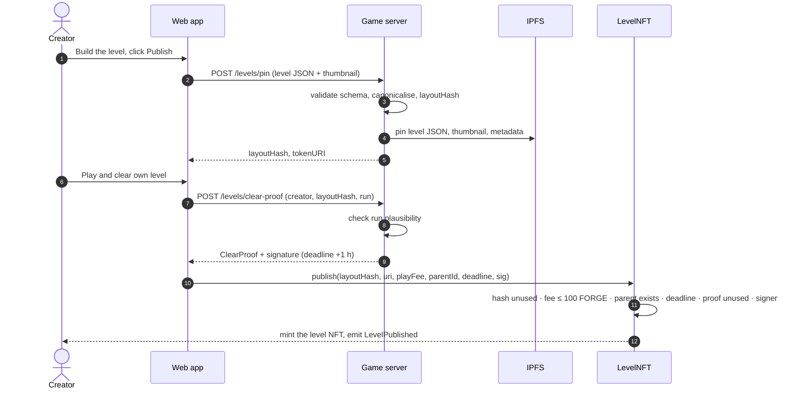
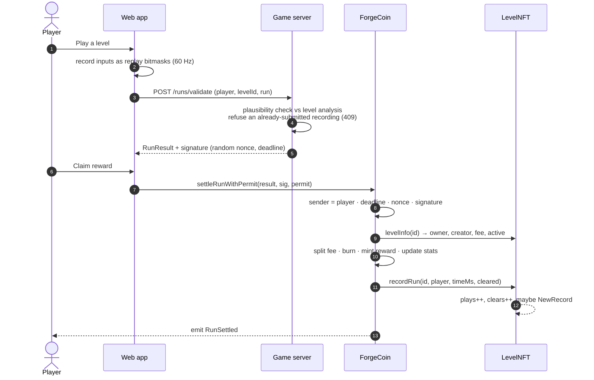
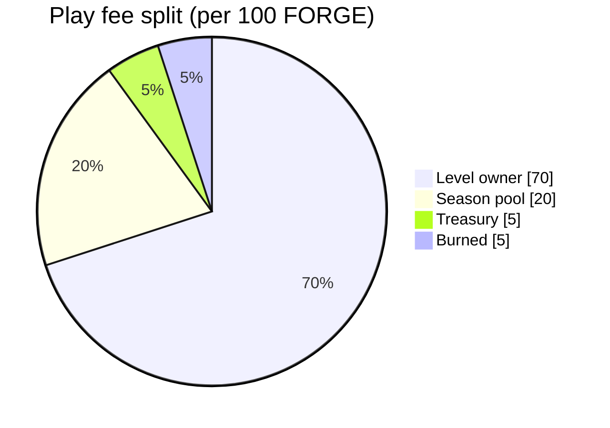
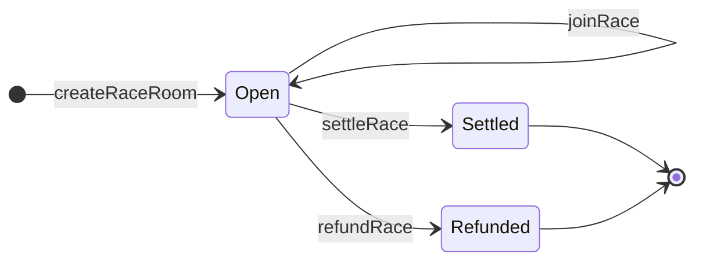
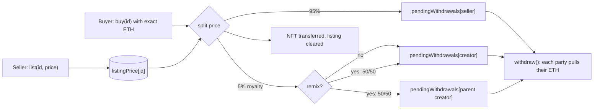
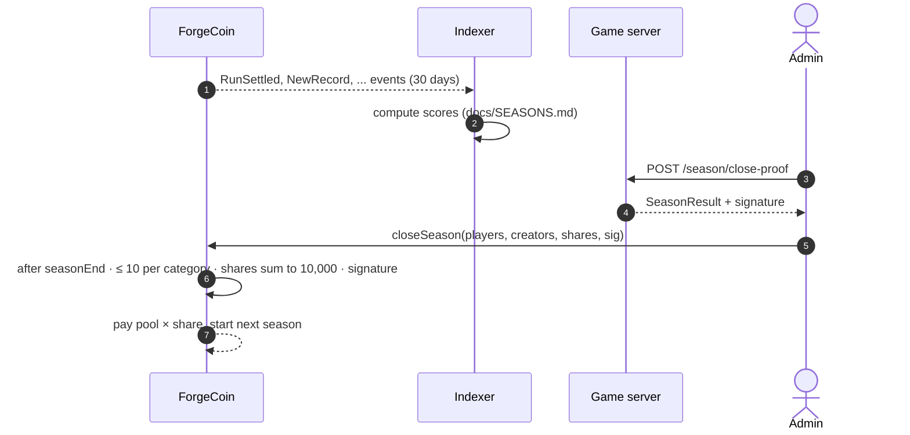
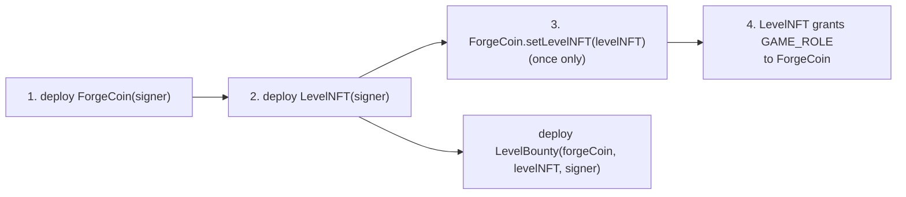

# How the blockchain side of RealmForge works

This document explains what RealmForge puts on the blockchain, what it keeps off it, and how a level, a run, a
race or a season goes from the browser to a confirmed transaction. It is written for players who want to know
what they are signing, and for the oral exam (security, performance and design choices).

The same file is shown in the app at **/how-it-works** and exported to `docs/RealmForge_Blockchain.pdf`.

## 1. The big picture

RealmForge uses two token contracts plus three satellite contracts (bounties, auctions, badges):

| Contract | Standard | What it holds | Owner of the design |
|---|---|---|---|
| `LevelNFT` | ERC-721 + ERC-2981 (royalties) + EIP-712 | one NFT per published level, level stats, a fixed-price ETH market | Student A |
| `ForgeCoin` | ERC-20 + ERC-2612 Permit + Capped + Pausable + EIP-712 | the FORGE token, play fees, rewards, race escrow, season pool | Student B |
| `LevelBounty` | AccessControl + EIP-712 + pull escrow | sponsor-funded FORGE bounties, winner payouts and post-expiry sponsor refunds | Shared feature |
| `LevelAuction` | ERC-721 receiver + ReentrancyGuard + ERC-2981 | escrowed English auctions of level NFTs, pull refunds for outbid bidders | Shared feature |
| `RealmBadges` | ERC-1155 (soulbound, ERC-5192-style lock) + EIP-712 | non-transferable achievement badges with on-chain SVG art | Shared feature |

**No gameplay runs on-chain.** Physics, the editor, multiplayer rooms and run validation all happen off-chain,
in the browser and on the game server. The chain only holds three things:

1. **Ownership**: who owns which level.
2. **The economy**: FORGE balances, fees, rewards, stakes and prizes.
3. **Settlement**: the final, signed result of a run, a race or a season.

Gameplay stays off-chain because a 60 Hz physics simulation would cost a transaction per frame, and a block
time of about 12 seconds cannot carry a real-time race.



## 2. The trust model: one signer, checked by the contracts

The contracts cannot watch a game being played, so they need someone to say "this run really happened". That
someone is the **game server**. It replays or checks the run, then signs the result with an
[EIP-712](https://eips.ethereum.org/EIPS/eip-712) typed signature. The player sends that signature to the
contract, which checks it before paying anything.

Each signed message is bound to:

| Field | What it prevents |
|---|---|
| `chainId` (in the domain) | reusing a Hardhat signature on Sepolia, or the other way round |
| `verifyingContract` (in the domain) | reusing a `LevelNFT` signature against another contract |
| `nonce` (random, 256 bits) | submitting the same run twice |
| `deadline` (default 1 hour) | using an old or leaked signature later |
| `player` / `creator` + `msg.sender` check | someone else cashing in my signed run |

The EIP-712 domains are `RealmForge LevelNFT`, `RealmForge ForgeCoin`, and `RealmForge LevelBounty`, all version `"1"`. The signed
types are, word for word:

```text
ClearProof(address creator,bytes32 layoutHash,uint256 deadline)
RunResult(address player,uint256 levelId,uint32 timeMs,bool cleared,uint16 coins,uint256 nonce,uint256 deadline)
RaceResult(bytes32 roomId,address[] ranking,uint256 deadline)
SeasonResult(uint256 season,address[] players,address[] creators,uint256[] shares)
BountyClaim(uint256 bountyId,uint256 levelId,address player,uint32 timeMs,uint256 nonce,uint256 deadline)
```

A server test compares these strings with the Solidity source, so the two sides cannot drift apart.

### Level bounties

A sponsor approves `LevelBounty` to spend FORGE, then creates a bounty for an existing level. Other wallets can
top it up without changing its terms. A target time of zero accepts any validated clear; otherwise the run must
finish at or below the target. Expiry is optional: after a nonzero expiry, each sponsor can pull back its own
contribution. A never-expiring bounty has no refund path. The server revalidates a clear and signs
`BountyClaim`; the player submits it, and the first mined qualifying claim receives the whole escrow. The
contract rejects the current level owner, original creator, and any sponsor, and marks the bounty claimed before
transferring FORGE. The `LevelBounty` signer key is a separate role on that contract and uses its own domain.

> **The signer is a centralisation point, and we say so.** Whoever holds the signer key can claim that any run
> happened. The contracts limit the damage (per-run reward caps, 200 FORGE per player per day, a 100 M supply
> cap) and the admin can rotate the key with `setSigner` or stop everything with `pause`. The full analysis is in
> [`docs/security/THREAT_MODEL.md`](security/THREAT_MODEL.md).



## 3. Where a level lives

A level is a JSON document (`level.v1.json`). It is too large to store on-chain at a reasonable price, so:

1. The JSON is **canonicalised** (sorted keys, fixed number formatting) so that the same level always gives the
   same bytes.
2. Its hash, `layoutHash = keccak256(canonical JSON)`, is the level's fingerprint.
3. The JSON, a thumbnail and an ERC-721 metadata file are **pinned on IPFS**.
4. Only the `layoutHash` and the token URI (`ipfs://<metadata CID>`) go on-chain.

Anyone can download the JSON from IPFS, hash it and compare with the on-chain `layoutHash`: if one byte changed,
the hash no longer matches. The web client and the server share a test vector to make sure they hash the same
level to the same value.

`LevelNFT` also refuses a `layoutHash` that was already published (`hashUsed`), so nobody can mint a copy of
someone else's level byte for byte.

## 4. Publishing a level (LevelNFT)

Before a level can be minted, its creator must **finish it themselves** in the editor. This stops people from
publishing impossible levels to collect fees. The proof is a server-signed `ClearProof`.



What the creator chooses at publish time:

- **`playFee`**: what each player pays per run, from 0 to 100 FORGE.
- **`parentId`**: 0 for an original level, or the id of the level it remixes (the parent creator then shares
  royalties).

After publishing, the owner can change the fee (`setPlayFee`), take the level offline (`setActive(false)`), and
anyone can `like` it once.

### Remixes and lineage

Any level can be **remixed**: "Remix" on a level page copies its layout into the editor. The remixer must
change it (the server refuses an identical `layoutHash`) and clear it like any new level, then publishes it with
`parentId` = the source level. `LevelNFT.publish` checks the parent exists (`ParentNotFound`) and stores
`parentId` in the level's stats, so the family tree is on-chain and public.

- The level page shows the **lineage**: its parent chain up to the original, and its direct remixes
  (`GET /levels/:id/remixes`, built from the indexed `LevelPublished` events).
- On a sale through the built-in market, the 5% royalty (`REMIX_ROYALTY_BPS = 500`) is split 50/50 between the
  remix's creator and the **direct parent's** creator, so remixing pays the original author too (see section 8).
  External marketplaces only see the standard ERC-2981 royalty, paid to the remix's creator.

## 5. The FORGE token (ForgeCoin)

FORGE is a standard ERC-20 with 18 decimals and a hard cap of **100,000,000 FORGE**. New FORGE only appears in two
ways:

- **The faucet**: `claimFaucet()` gives 100 FORGE once per address, so a new player can start playing. To limit
  fake wallets, the faucet mints at most 10,000 FORGE per UTC day across everyone.
- **Rewards**: clearing someone else's level mints FORGE to the player (see §6).

FORGE leaves circulation through a **burn**: 5% of every play fee is destroyed.

FORGE supports **ERC-2612 Permit**, so a player can sign the fee approval off-chain and settle a run in a single
transaction (`settleRunWithPermit`) instead of two (`approve` then `settleRun`).

## 6. Playing a level and settling the run

This is the most common transaction in the game.



### Where the play fee goes



The split is done in basis points (`OWNER_BPS = 7000`, `POOL_BPS = 2000`, the rest to the treasury, half of
which is burned). Any rounding remainder goes to the treasury, so `owner + pool + treasury == fee` always holds,
which a fuzz test checks.

### How the reward is computed

The reward is only paid for a **cleared** run by someone who is **not** the level's owner or original creator
(otherwise an owner could farm their own level):

| Part | Amount |
|---|---|
| Base + difficulty | `5 + 45 × (1 − clears / plays)` FORGE, at most 50 |
| First clear ever of the level | +20 FORGE |
| New best time | +10 FORGE |
| In-game coins | +0.1 FORGE per coin, at most +5 |

The total is then clipped to what is left of the player's **200 FORGE daily cap** and of the global supply cap.
Hard levels (few clears per play) pay more than easy ones, which rewards creators who make good challenges and
players who beat them.

### Gasless settle (relayer)

A new player has FORGE from the faucet but no ETH for gas. They can still settle a run:

1. The browser asks the player for **two free signatures**: the EIP-712 `RunResult` (proves the player agrees
   to this exact result) and an ERC-2612 `Permit` for the play fee.
2. It sends both to `POST /relay/settle`. The server's relayer wallet calls
   `ForgeCoin.settleRunFor(result, serverSig, playerSig, permit…)` and pays the gas.
3. The contract checks the **player's** signature over the same `RunResult` (`InvalidPlayerSignature`), then the
   server's, then the permit, and emits `RunRelayed(player, relayer, nonce)`.

The relayer cannot change the result or redirect the reward: everything it submits is signed by the player.
Abuse is capped by a daily quota per wallet (`RELAY_DAILY_QUOTA`, 10 by default) and a gas limit per relay
(`RELAY_GAS_LIMIT`). `GET /relay/status` tells the app whether gasless mode is available.

## 7. Versus races (escrow)

In a race, 2 to 4 players stake the same amount of FORGE, race in real time in a Colyseus room, and the server
signs the ranking.



| Call | Who | Rule |
|---|---|---|
| `createRaceRoom(roomId, levelId, stake)` | the room creator | escrows the creator's stake; the level must be active |
| `joinRace(roomId)` | each other player | escrows the same stake; at most 4 players, within 1 hour |
| `settleRace(roomId, ranking, deadline, sig)` | anyone | needs the server's `RaceResult` signature |
| `refundRace(roomId)` | anyone | only after 1 hour without settlement; returns every stake |

When the race settles, the pot (`stake × players`) is paid as:

| Recipient | Share |
|---|---|
| 1st place | 60% |
| 2nd place | 25% |
| Level owner | 10% |
| Season pool | 5% + rounding dust |

The contract checks that the 1st and 2nd places are two different players of that room before it checks the
signature. If the server never signs (crash, network, disconnect), **anyone** can call `refundRace` after one hour,
**even while the contract is paused**, so stakes can never be trapped. An invariant test checks that the contract
always holds exactly the stakes, pool and treasury it owes.

## 8. The level market and royalties (ETH)

Levels are NFTs, so they can be resold. `LevelNFT` has a built-in fixed-price market paid in **ETH**:



Two design choices matter here:

- **Pull payments.** `buy` never sends ETH. It only credits `pendingWithdrawals`, and each party calls
  `withdraw()` later. A seller whose wallet rejects ETH cannot block a sale, and there is no reentrancy surface
  during the transfer.
- **ERC-2981.** External marketplaces (OpenSea and others) can read `royaltyInfo` and pay the 5% royalty to the
  creator. ERC-2981 only supports one receiver, so the remix split only applies to the built-in market
  (`TODO(studentA)` in the contract).

Whoever owns the NFT receives the 70% of play fees, so buying a popular level is buying its income.

### Auctions (LevelAuction)

Besides the fixed-price market, an owner can put a level up for an **English auction**:

| Rule | Value |
|---|---|
| Duration | 1 hour to 30 days (`MIN_DURATION`, `MAX_DURATION`) |
| Bids | at least the reserve, then at least the previous bid + the minimum raise |
| Anti-sniping | a bid in the last 10 minutes extends the end by 10 minutes |
| Outbid bidders | refunded by **pull** (`withdraw`), so a reverting bidder cannot block the auction |
| Cancel | only while there are no bids |
| Settle | anyone, after the end: NFT to the winner, ETH to the seller minus the ERC-2981 royalty |

While the NFT is escrowed in the auction contract, the level is **paused** (`setActive(false)`) and reactivated
when it leaves: otherwise ForgeCoin would send the 70% owner share of play fees to the auction contract, where
nobody could withdraw it. Settle uses `transferFrom` (not `safeTransferFrom`), so a winner contract without an
ERC-721 receiver cannot block the payout.

## 9. Seasons

Every 30 days, the **season pool** (20% of play fees + 5% of race pots) is shared between the top 10 players and
the top 10 creators.



Closing a season needs **two keys**: the server signs the result and the admin submits it. A leaked signer key
alone cannot empty the pool. Every input is a public event, so anyone can recompute the ranking and compare. The
scoring rules are in [`docs/SEASONS.md`](SEASONS.md).

## 10. Badges, ghosts, sign-in and co-op

### Soulbound badges (RealmBadges)

Achievements are **ERC-1155 badges that cannot be transferred** (an ERC-5192-style `locked() = true`; every
transfer and approval reverts). There are four: First clear, Record holder, Race winner and Creator. The server checks the
achievement against indexed events and signs an EIP-712 `BadgeClaim(holder, badgeId, ref, nonce, deadline)`
(`POST /badges/claim-proof`); the player claims it with `RealmBadges.claim`. Each `(holder, badge, ref)` can be
claimed once. The badge art is an SVG built on-chain (`uri()` returns a data URI), so it needs no server or IPFS.

### Ghost replays

Every validated run is stored with its input log (`signed_runs`). `GET /levels/:id/replays` returns the best ones,
and the game replays them **deterministically** next to the player, because the physics step is fixed. Racing
the record holder's ghost needs no transaction; beating it is settled like any run and moves the on-chain record.

### Sign-In With Ethereum (SIWE)

Multiplayer rooms only accept wallets that proved control of their address. The app asks once for an
**EIP-4361** message signature (`GET /auth/nonce` → sign → `POST /auth/verify`); the server checks the domain,
nonce and expiry and returns a session valid for one hour (`SESSION_TTL_SEC`). A signature costs no gas. Room
joins carry the session, so nobody can join a staked race under someone else's address. Spectators join without
a wallet and never get a player slot.

### Co-op and spectators

In a co-op room, players share **checkpoints**: when anyone reaches one, the whole team respawns there. The room
refuses a checkpoint that skips ahead (`idx ≤ sharedCheckpoint + 1`). A team clear is validated per player and
settled like a normal run. Spectators watch races and co-op live, read-only.

## 11. How the app reads the chain

Reading state straight from the contracts for every list would be slow and would need `ERC721Enumerable`, which
costs extra storage on every mint. Instead:

- The **indexer** in `server/` follows `LevelNFT`, `ForgeCoin`, `LevelBounty`, `LevelAuction` and `RealmBadges` events with viem, and writes them to SQLite.
  It remembers the last processed block, so it can restart and catch up.
- The **API** serves level lists, leaderboards, market listings, profiles and season scores from that database.
- The **web app** reads small, live values directly with wagmi (your FORGE balance, a race room, the season
  pool) and sends every transaction from your own wallet. The server never holds player funds or player keys.

## 12. Security summary

| Rule | Where |
|---|---|
| OpenZeppelin v5 for every standard, no hand-written ERC code | both contracts |
| `nonReentrant` on every function that moves value; checks → effects → interactions | `buy`, `withdraw`, `settleRun`, races, `closeSeason` |
| Pull payments for ETH | `LevelNFT.withdraw` |
| Custom errors and an event for every state change | both contracts |
| Roles with `AccessControl` (`GAME_ROLE`, `SIGNER_ROLE`, `DEFAULT_ADMIN_ROLE`) | both contracts |
| Signatures bound to nonce, deadline, chain and contract | every EIP-712 message |
| Circuit breaker that never traps funds (`pause`, while `refundRace` and transfers keep working) | `ForgeCoin` |
| Bounded loops: at most 4 race players and 10 winners per season category | `ForgeCoin` |
| Not upgradeable: the rules cannot change after deployment | both contracts |
| Permit front-running handled with `try/catch` | `settleRunWithPermit` |
| Relayed runs need the player's own EIP-712 signature; daily relay quota per wallet | `settleRunFor`, `/relay/settle` |
| Pull refunds and anti-sniping; escrowed levels are paused so fees are never stranded | `LevelAuction` |
| Badges are soulbound: transfers and approvals revert | `RealmBadges` |
| Rooms require a SIWE session (EIP-4361) before a player slot is given | `BaseMatchRoom` |

The threat model ([`docs/security/THREAT_MODEL.md`](security/THREAT_MODEL.md)) lists each threat with its test,
and [`docs/security/SLITHER.md`](security/SLITHER.md) has the static analysis results.

## 13. Gas and performance

Typical costs measured on the integration tests ([`docs/GAS.md`](GAS.md)):

| Action | Gas |
|---|---|
| Publish a level | 250 k – 270 k |
| Settle a run (with permit, one transaction) | about 257 k |
| Create a race / join a race | 184 k / 75 k – 80 k |
| Buy a level / withdraw | 88 k / 40 k |
| Claim the faucet | 82 k – 116 k |

The main savings: tightly packed level stats (one storage slot for fee, plays, clears, likes and best time), no
`ERC721Enumerable`, internal transfers for the fee split, and the permit path that saves an `approve`
transaction.

## 14. Deployment

| Network | Chain id | Use |
|---|---|---|
| Hardhat local | 31337 | development (`npm run deploy:local`) |
| Sepolia | 11155111 | class demo |

Existing Sepolia addresses (from `contracts/ignition/deployments/chain-11155111/deployed_addresses.json`):

| Contract | Address |
|---|---|
| `LevelNFT` | `0xC040D6E51e6e59f1764Bc30c1Cf5fB40E4736f09` |
| `ForgeCoin` | `0x5d40434c1B59F4f2Be0B986373C074571133421e` |
| `LevelBounty`, `LevelAuction`, `RealmBadges` | Not deployed on Sepolia yet; all deployed locally by `npm run deploy:local` |

The Ignition module (`contracts/ignition/modules/RealmForge.ts`) deploys the three contracts. ForgeCoin calls
LevelNFT and LevelNFT must allow it; LevelBounty receives both addresses and the server signer:



After any contract change, `contracts/scripts/export-abi.ts` regenerates the ABIs used by `web/` and `server/`.

## 15. Known limits

- **The signer is trusted** to say a run happened. The server checks that the position trace is plausible
  (starts at the spawn, never moves faster than the physics allows, hits the checkpoints in order, ends at the
  goal, is not faster than the level's minimum time, and collects no more coins than the level holds). Full headless replay of the input log is a stretch goal.
- **Fake wallets** can still collect the faucet and rewards. The daily faucet budget and the 200 FORGE per-day
  cap per wallet bound the damage, but cannot stop it.
- **Seasons are not automatic**: someone has to send `closeSeason` after the end date.
- **Race room ids** are chosen off-chain, so someone could create a room id first and block that one room
  (low impact).
- FORGE has no market value: this is a testnet demo.
